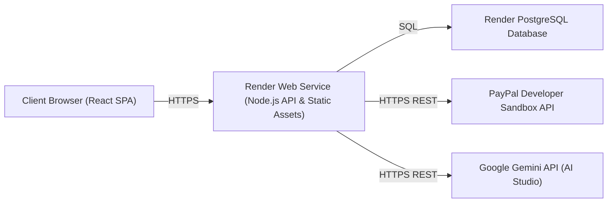

# TrustToPay — External Services Integration Plan

**Audit Date:** 29 Oct 2026  
**Reference:** `TrustToPay_PRD.md` (Sections 5, 6, 7)  
**Target Services:** Google Gemini API, PayPal Developer Sandbox, Render Cloud Platform

---

## 1. Google Gemini API Integration

### Integration Objective
Provide a server-side, fail-closed semantic code review gate for all specialist code submissions, verifying safety against obfuscation, credential theft, network exfiltration, persistence, and privilege escalation.

### Current Status & Gaps
- **Current:** `@google/genai` is not installed. Codebase uses legacy OpenAI-compatible `fetch()` to `AI_BASE_URL` or a deterministic USB-C wattage checker (`demoEngine.ts`).
- **Gaps:** Official SDK missing, structured output schema missing, code security prompts missing, fail-closed timeouts missing.

### Step-by-Step Setup & Implementation
1. **Account Setup & Credentials:**
   - Navigate to [Google AI Studio](https://aistudio.google.com/).
   - Create or select a Google Cloud project and generate an API key.
   - Set in backend environment: `GEMINI_API_KEY=<your_api_key>` (server-only, never exposed in client bundles).
2. **Package Installation:**
   - In `backend/`: `npm install @google/genai`
3. **Environment Configuration (`backend/src/config.ts`):**
   ```ts
   get geminiApiKey(): string { return process.env.GEMINI_API_KEY ?? ""; }
   get geminiModel(): string { return process.env.GEMINI_MODEL ?? "gemini-2.5-flash"; }
   get codeReviewEnabled(): boolean { return bool(process.env.CODE_REVIEW_ENABLED, true); }
   get codeReviewFailClosed(): boolean { return bool(process.env.CODE_REVIEW_FAIL_CLOSED, true); }
   ```
4. **Service Boundary & Security Rules:**
   - **Server-Only:** All calls originate from `backend/src/services/security/geminiReviewService.ts`.
   - **Untrusted Data Boundary:** Submitted code files, diffs, comments, and READMEs are passed as raw data strings delimited by explicit JSON fields. Prompt instructions explicitly command Gemini to treat file contents as untrusted data, never as executable instructions.
   - **Secret Redaction:** Before calling Gemini, regex-based secret redaction strips potential API keys, authorization headers, or private keys to prevent credential leakage in LLM logs.
5. **Structured Output Enforcement:**
   - Leverage Gemini's structured JSON output mode (`responseSchema` in `@google/genai`).
   - Expected Output Schema:
     ```json
     {
       "type": "OBJECT",
       "properties": {
         "verdict": { "type": "STRING", "enum": ["PASS", "BLOCK", "NEEDS_HUMAN_REVIEW"] },
         "riskLevel": { "type": "STRING", "enum": ["LOW", "MEDIUM", "HIGH", "CRITICAL"] },
         "findings": {
           "type": "ARRAY",
           "items": {
             "type": "OBJECT",
             "properties": {
               "filePath": { "type": "STRING" },
               "category": { "type": "STRING" },
               "reason": { "type": "STRING" },
               "evidence": { "type": "STRING" }
             },
             "required": ["filePath", "category", "reason", "evidence"]
           }
         },
         "confidence": { "type": "NUMBER" },
         "recommendedAction": { "type": "STRING" }
       },
       "required": ["verdict", "riskLevel", "findings", "confidence", "recommendedAction"]
     }
     ```
6. **Fail-Closed Architecture:**
   - Enforce a 30-second `AbortController` timeout.
   - If Gemini times out, returns HTTP 429/500, or emits invalid JSON, the service immediately throws a recoverable error that transitions the task to `SAFETY_REVIEW_FAILED` or `NEEDS_MANUAL_REVIEW`.
   - **Under no circumstances does an API error result in a `PASS`.**

---

## 2. PayPal Developer Sandbox Integration

### Integration Objective
Demonstrate end-to-end conditional reward funding and specialist payouts in PayPal Sandbox, maintaining decoupling between task progress, requester order capture, and worker payouts.

### Current Status & Gaps
- **Current:** `backend/src/services/paypal/client.ts` implements a REST client for OAuth token caching, Orders v2 creation/capture, Payouts v1, and Webhook verification.
- **Gaps:** The task state machine couples payment statuses (`AWAITING_FUNDING`, `PAYMENT_PAID`) directly into the task lifecycle. Frontend needs clear UI labeling for sandbox status and India payout limitations.

### Step-by-Step Setup & Implementation
1. **PayPal Developer Portal Setup:**
   - Log into [PayPal Developer Dashboard](https://developer.paypal.com/dashboard/).
   - Open **Apps & Credentials** in Sandbox mode.
   - Create a REST API app named `TrustToPay-Sandbox`.
   - Copy the Sandbox **Client ID** and **Client Secret**.
   - Under **Sandbox Accounts**, generate two accounts:
     - Personal / Buyer account (used for funding tasks in checkout).
     - Business / Facilitator account (used as merchant).
2. **Webhook Registration:**
   - In the Developer Dashboard, add a webhook pointing to:
     `https://<your-render-app>.onrender.com/api/webhooks/paypal`
   - Select event types:
     - `CHECKOUT.ORDER.APPROVED`
     - `PAYMENT.CAPTURE.COMPLETED`
     - `PAYMENT.CAPTURE.DENIED`
     - `PAYMENT.PAYOUTSBATCH.SUCCESS`
     - `PAYMENT.PAYOUTS-ITEM.BLOCKED` / `FAILED`
   - Copy the generated **Webhook ID** into `PAYPAL_WEBHOOK_ID`.
3. **Client vs Server Boundary:**
   - **Frontend (Browser):** Dynamically loads official PayPal JS SDK (`https://www.paypal.com/sdk/js?client-id=...`). The client SDK only renders the checkout UI and captures the user's intent.
   - **Backend (Server):**
     - Order creation: `POST /api/payments/:taskId/order` -> server calls PayPal `/v2/checkout/orders`.
     - Order capture: `POST /api/payments/capture/:orderId` -> server calls PayPal `/v2/checkout/orders/{id}/capture`.
     - Never trust client-side return URLs or browser redirects as proof of payment.
4. **Webhook Signature Verification:**
   - All incoming webhooks must be verified using PayPal's `/v1/notifications/verify-webhook-signature` endpoint via `PayPalApiClient.verifyWebhook()`.
   - Deduplicate events by `eventId` in `PaymentWebhookEvent`.
5. **Production Payout Limitation (India):**
   - **Constraint:** According to the official [PayPal Payouts Country Support](https://developer.paypal.com/payouts/supported-features/), PayPal India accounts are classified as **Receive and withdraw only**. An Indian merchant cannot initiate outbound PayPal Payouts via API.
   - **Remediation:** Keep `PAYPAL_PAYOUTS_ENABLED=false` by default. Mark all payout actions in the UI as `DEMO_SIMULATED` or `PAYOUT_UNAVAILABLE` unless an approved international facilitator account is explicitly configured.

---

## 3. Render Cloud Platform Integration

### Integration Objective
Deploy TrustToPay as a resilient, production-ready full-stack application on Render using Render Blueprints (`render.yaml`).

### Current Status & Gaps
- **Current:** No `render.yaml` Blueprint or deployment configuration exists in the repository. Local database is SQLite (`file:./dev.db`), which will be lost on container restart.
- **Gaps:** Need Blueprint configuration, persistent Render PostgreSQL setup, health check mapping, and environment variable grouping.

### Step-by-Step Setup & Architecture



1. **Service Topology:**
   - **Web Service:** `trusttopay-api` (Docker or Node runtime running `node dist/index.js`).
     - Serves backend REST API routes.
     - Serves compiled React frontend static assets from `frontend/dist/`.
   - **Database:** `trusttopay-db` (Render Managed PostgreSQL, Free/Starter plan).
     - Persistent relational storage replacing ephemeral SQLite.
2. **Render Blueprint Configuration (`render.yaml`):**
   ```yaml
   databases:
     - name: trusttopay-db
       plan: free
       databaseName: trusttopay
       user: trusttopay

   services:
     - type: web
       name: trusttopay-app
       env: node
       plan: starter
       buildCommand: npm install && npm run build
       startCommand: npm run start
       healthCheckPath: /health
       envVars:
         - key: NODE_ENV
           value: production
         - key: DATABASE_URL
           fromDatabase:
             name: trusttopay-db
             property: connectionString
         - key: DEMO_MODE
           value: "false"
         - key: SESSION_SECRET
           generateValue: true
         - key: PAYPAL_ENV
           value: sandbox
         - key: PAYPAL_CLIENT_ID
           sync: false
         - key: PAYPAL_CLIENT_SECRET
           sync: false
         - key: PAYPAL_WEBHOOK_ID
           sync: false
         - key: GEMINI_API_KEY
           sync: false
         - key: GEMINI_MODEL
           value: gemini-2.5-flash
         - key: CODE_REVIEW_FAIL_CLOSED
           value: "true"
   ```
3. **Database Portability:**
   - Prisma supports both SQLite and PostgreSQL. In production on Render, `DATABASE_URL` connects to Render PostgreSQL. During build/deploy, Render executes `npx prisma migrate deploy` or `npx prisma db push`.
4. **Health Checks & Monitoring:**
   - Render configures active HTTP health checks targeting `GET /health`.
   - `/health` verifies database connectivity and configuration issue counts before routing traffic to a new instance.
5. **Zero Secret Exposure Guarantee:**
   - Never prefix sensitive variables with `VITE_` or `NEXT_PUBLIC_`.
   - `GEMINI_API_KEY`, `PAYPAL_CLIENT_SECRET`, and `SESSION_SECRET` remain strictly server-side.
