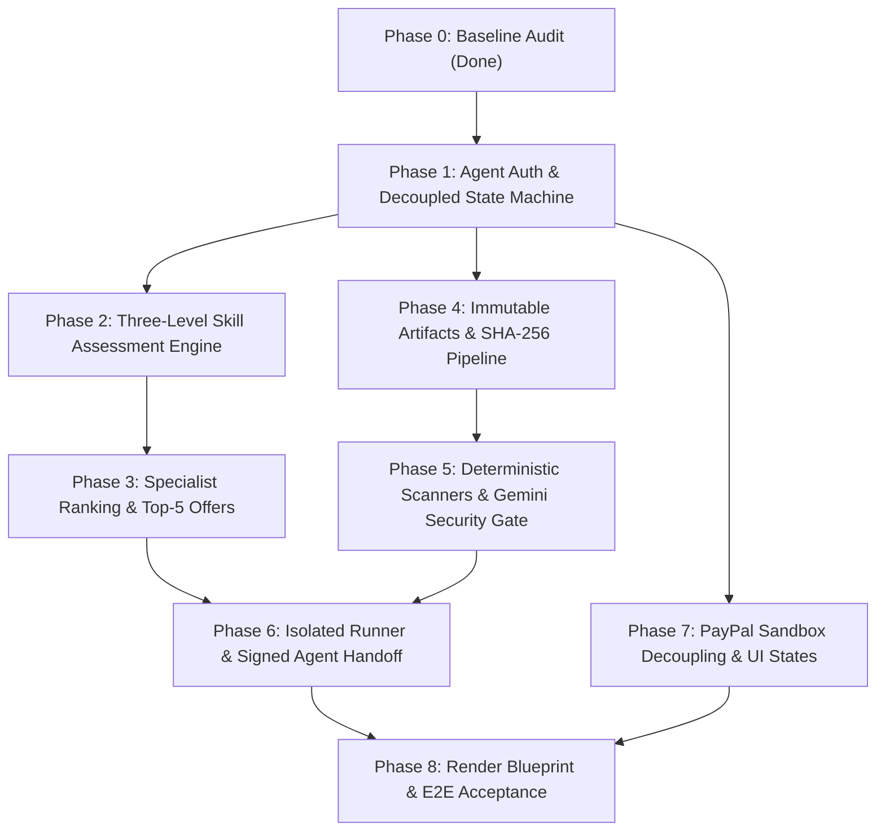

# TrustToPay — Phased Implementation Roadmap

**Reference:** `TrustToPay_PRD.md`  
**Baseline:** 95 tests passing (64 backend, 31 frontend), zero build errors.  
**Strategy:** Dependency-ordered, backward-compatible, bite-sized units suitable for Google AI Studio execution.

---

## Roadmap Overview



---

## Phase 1: Agent Authentication, API Credentials & Decoupled State Machine

### Goal & Scope
Enable autonomous AI agents to authenticate programmatically via Bearer API keys and submit idempotent tasks, while decoupling the task state machine from financial transactions.

### Files Affected
- `backend/prisma/schema.prisma` (Add `AgentApiKey` model, update `ReviewTask` status enum)
- `backend/src/auth/middleware.ts` (Support `Authorization: Bearer <token>` in `attachUser`)
- `backend/src/auth/service.ts` (API key hashing and verification)
- `backend/src/services/stateMachine.ts` (Decouple task status: `DRAFT`, `QUEUED`, `MATCHING`, `OFFERED`, `ASSIGNED`, `IN_PROGRESS`, `SUBMITTED`, `SAFETY_CHECKING`, `VERIFICATION_RUNNING`, `VERIFIED`, `HANDED_OFF`, `COMPLETED`)
- `backend/src/routes/tasks.ts` (Accept `Idempotency-Key` header and agent caller)
- `backend/src/test/auth.test.ts` & `workflow.test.ts`

### Prerequisites
None (builds on Phase 0 baseline).

### Implementation Steps
1. Add `AgentApiKey` to `schema.prisma` (`id`, `userId`, `keyHash`, `prefix`, `name`, `lastUsedAt`, `createdAt`, `revokedAt`).
2. Update `backend/src/auth/middleware.ts` so `attachUser` checks `req.headers.authorization` for `Bearer ttp_live_...` or `ttp_test_...` and resolves the associated `User`.
3. Refactor `backend/src/services/stateMachine.ts` to implement PRD Section 4 task statuses, keeping financial transactions (`PaymentTransaction`) on their own status track.
4. Support `Idempotency-Key` on `POST /api/tasks` using Prisma transaction checking.
5. Create Prisma migration and update unit tests.

### Acceptance Criteria & Tests
- [x] Agent can issue a request with `Authorization: Bearer <key>` and be recognized as role `REQUESTER`.
- [x] Duplicate task submissions with the same idempotency key return the original task without duplicate records.
- [x] State machine rejects invalid transitions (e.g. `ASSIGNED` -> `COMPLETED` without verification).
- [x] Existing 64 backend tests continue to pass.

---

## Phase 2: Three-Level Skill Assessment & Sequential Verification Engine

### Goal & Scope
Eliminate self-reported skills. Implement the PRD's three sequential assessment levels (L1 Foundation, L2 Practitioner, L3 Advanced), requiring practical tests before granting verified skill tags.

### Files Affected
- `backend/prisma/schema.prisma` (Add `Skill`, `AssessmentStage`, `SkillAssessmentAttempt`, `UserSkillLevel`)
- `backend/src/routes/users.ts` (Remove free-form skill creation in `PATCH /me/payout`)
- `backend/src/routes/skills.ts` (New route: list skills, start assessment stage, submit assessment answers)
- `backend/src/services/skills/assessmentEngine.ts` (Grading logic, sequential unlock rule: L1 -> L2 -> L3)
- `backend/prisma/seed.ts` (Seed technical coding skills: TypeScript, Python, Smart Contracts, System Architecture)
- `frontend/src/pages/profile.tsx` & `frontend/src/components/status-badges.tsx` (Display verified L1-L3 badges)

### Prerequisites
Phase 1 (data model stability).

### Implementation Steps
1. Define `Skill` (`id`, `name`, `category`, `description`, `version`) and `AssessmentStage` (`skillId`, `level: 1|2|3`, `passingScore`, `questionsJson`) in Prisma.
2. Build `assessmentEngine.ts`: enforce sequential unlocking. L2 is blocked until L1 is passed; L3 is blocked until L2 is passed. Failed attempts trigger a cooldown.
3. Remove arbitrary skill editing from `backend/src/routes/users.ts`.
4. Create test suite `backend/src/test/skills.test.ts` testing sequential unlocks, grading, and cheating prevention.

### Acceptance Criteria & Tests
- [x] A user cannot attempt an L2 assessment without an active, passed L1 record.
- [x] Failing an assessment stage does not grant the level or revoke previously passed lower levels.
- [x] User skills cannot be manually updated via API without passing assessments.

---

## Phase 3: Specialist Ranking & Top-Five Parallel Offer Broadcast

### Goal & Scope
Replace the single open marketplace with an explainable multi-signal ranking algorithm that dispatches expiring offers to the top five eligible specialists in parallel, with atomic first-accept locking.

### Files Affected
- `backend/prisma/schema.prisma` (Add `TaskOffer` model: `taskId`, `specialistId`, `score`, `status: PENDING|ACCEPTED|DECLINED|EXPIRED`, `expiresAt`)
- `backend/src/services/matching/rankingService.ts` (Hard filters + weighted scoring: skill level, completion rate, reliability, speed)
- `backend/src/services/matching/offerDispatcher.ts` (Batch offer creator, 15-minute offer TTL, timeout expiry handler)
- `backend/src/routes/tasks.ts` (Update `/:id/accept` to accept a pending offer, invalidate other batch offers, atomic winner selection)
- `backend/src/test/matching.test.ts` (Concurrency race test proving exactly one winner among parallel accepts)

### Prerequisites
Phase 1 (state machine) and Phase 2 (verified skill levels).

### Implementation Steps
1. Add `TaskOffer` table with unique constraint on `[taskId, specialistId]`.
2. Implement `RankingService`:
   - Hard filters: verified required skill level, account active & approved, not current requester, within active workload limit.
   - Scoring signals: matching skill level weight (50%), historical verification rate (30%), average response time (20%).
3. Implement `offerDispatcher.ts`: select top 5 scored specialists, create `TaskOffer` with `expiresAt = now + 15m`, transition task to `OFFERED`.
4. Update `POST /api/tasks/:id/accept`: ensure user has an active `TaskOffer`, acquire row lock, transition task to `ASSIGNED`, mark winning offer `ACCEPTED` and all other offers for that task `EXPIRED`.

### Acceptance Criteria & Tests
- [x] Automated test with 5 concurrent requests to `/accept` produces exactly 1 winner and 4 rejected/expired offers.
- [x] Specialists without the verified skill level are filtered out before ranking.
- [x] Task offer audit snapshot records matching reasons.

---

## Phase 4: Immutable Code Artifacts, File Validation & SHA-256 Digest Pipeline

### Goal & Scope
Enable specialists to submit software deliverables (git patches/diffs, file archives, changed files) rather than plain text strings. Enforce archive validation, path traversal guards, and immutable SHA-256 digest computation.

### Files Affected
- `backend/prisma/schema.prisma` (Add `SubmissionArtifact` model: `submissionId`, `version`, `sha256Digest`, `fileManifestJson`, `patchText`, `archiveUrl`)
- `backend/src/lib/artifacts.ts` (Path traversal prevention, zip bomb limit, forbidden extension detector)
- `backend/src/routes/tasks.ts` (Update `/:id/submit` to accept code artifacts/patches)
- `backend/src/test/artifacts.test.ts` (Malicious archive rejection, path traversal rejection, SHA-256 reproducibility)

### Prerequisites
Phase 1 (task lifecycle) and Phase 3 (assigned specialist).

### Implementation Steps
1. Add `SubmissionArtifact` linked to `ReviewSubmission`.
2. Build `backend/src/lib/artifacts.ts`:
   - Validate file paths: reject `..`, absolute paths (`/` or `C:\`), and symlinks.
   - Enforce archive limits: max 5 MB uncompressed, max 50 files, reject unexpected executables (`.exe`, `.dll`, `.sh`, `.bat`).
   - Calculate SHA-256 digest over canonicalized file contents and manifest.
3. Update `POST /api/tasks/:id/submit`: save versioned immutable artifact, record SHA-256 digest, set status to `SUBMITTED`.
4. Resubmission on rejection increments version number and computes a new hash, invalidating prior scans.

### Acceptance Criteria & Tests
- [x] Submitting an archive with `../evil.js` is quarantined and returns HTTP 400.
- [x] SHA-256 digest is deterministic and immutable across storage.
- [x] Any resubmission generates a new version number and invalidates all prior security and verification runs.

---

## Phase 5: Deterministic Scanners & Layered Gemini Security Gate (`@google/genai`)

### Goal & Scope
Implement the multi-layer security gate. First run deterministic secret scanners and syntax checks, then invoke Google Gemini via the official `@google/genai` SDK using structured output and fail-closed rules.

### Files Affected
- `backend/package.json` (Add `@google/genai`)
- `backend/src/config.ts` (Add `geminiApiKey`, `geminiModel`, `codeReviewEnabled`, `codeReviewFailClosed`)
- `backend/src/services/security/deterministicScanner.ts` (Secret pattern detection: API keys, private keys, high entropy strings)
- `backend/src/services/security/geminiReviewService.ts` (Official GenAI SDK, structured JSON output: `verdict`, `riskLevel`, `findings`)
- `backend/src/services/verification.ts` (Wire deterministic + Gemini gates into verification pipeline)
- `backend/src/test/security-gate.test.ts`

### Prerequisites
Phase 4 (artifact content and SHA-256 binding).

### Implementation Steps
1. Install `@google/genai` in `backend`.
2. Add `GEMINI_API_KEY`, `GEMINI_MODEL` (default: current supported Gemini Flash model, e.g. `gemini-2.5-flash`), `CODE_REVIEW_FAIL_CLOSED=true` to `config.ts`.
3. Create `deterministicScanner.ts`: scan changed files for exposed tokens (`sk-`, `ghp_`, private keys, AWS keys).
4. Create `geminiReviewService.ts` using `GoogleGenAI` from `@google/genai`:
   - Redact detected secrets and send changed code + task context as untrusted data.
   - Enforce structured output schema:
     ```json
     {
       "verdict": "PASS" | "BLOCK" | "NEEDS_HUMAN_REVIEW",
       "riskLevel": "LOW" | "MEDIUM" | "HIGH" | "CRITICAL",
       "findings": [{ "filePath": string, "category": string, "reason": string, "evidence": string }],
       "confidence": number,
       "recommendedAction": string
     }
     ```
   - Enforce fail-closed behavior: timeouts (>30s), rate-limit errors, or invalid JSON automatically result in `SAFETY_REVIEW_FAILED` or `NEEDS_HUMAN_REVIEW`, never `PASS`.

### Acceptance Criteria & Tests
- [x] Submissions with hardcoded API keys are caught by the deterministic scanner and blocked before reaching Gemini.
- [x] Malicious payloads (e.g. reverse shells, obfuscated eval) receive `verdict: "BLOCK"`.
- [x] Prompt injection in code comments or docstrings is treated as data, not instruction.
- [x] Gemini API timeout or network outage fails closed, preventing unreviewed code from progressing.

---

## Phase 6: Isolated Code Runner & Signed Agent Handoff

### Goal & Scope
Run task verification tests exclusively inside an isolated environment (or explicit labelled non-executing test fixtures). Return only the exact verified artifact digest to the requesting AI agent via signed callback or authenticated API.

### Files Affected
- `backend/src/services/execution/runner.ts` (Runner interface: execution boundary, CPU/memory/time limits, no host mounts, network disabled)
- `backend/src/services/execution/fixtureRunner.ts` (Labelled non-executing fixture for demo/hackathon environments without container isolation)
- `backend/src/routes/tasks.ts` (Endpoint `GET /api/tasks/:id/handback` returning structured verified payload)
- `backend/src/services/agentCallback.ts` (HMAC-SHA256 signed callback dispatch to agent webhook URL)
- `backend/src/test/execution-handback.test.ts`

### Prerequisites
Phase 4 (artifact hash) and Phase 5 (security gate pass).

### Implementation Steps
1. Implement `runner.ts` interface: execute acceptance test command with unprivileged limits. If containerized isolation is not configured, fallback to `fixtureRunner.ts` with explicit logging: `[RUNNER_MODE=FIXTURE_LABELLED]`. Never execute untrusted code directly in the Express process!
2. Create handback builder: package task ID, verified artifact SHA-256 digest, changed files manifest, test run summary, and safety review reference.
3. Implement signed callback dispatch using `crypto.createHmac("sha256", agentSecret)`.

### Acceptance Criteria & Tests
- [x] Untrusted code is never evaluated via `eval()` or direct `child_process.exec` in the application process.
- [x] Only artifacts that have passed both Gemini security review and test verification can be handed back.
- [x] Requesting agent receives exact matching SHA-256 digest and valid HMAC signature.

---

## Phase 7: PayPal Sandbox Decoupling & UI States

### Goal & Scope
Decouple financial ledger states from the new task state machine, verify India payout restriction handling, and update frontend views to present coding tasks, L1-L3 badges, parallel offers, and artifact security reports.

### Files Affected
- `backend/src/services/payments.ts` (Ensure payments operate asynchronously without locking task state machine)
- `frontend/src/pages/task-detail.tsx` (Add artifact viewer, security scanner results tab, sandbox payment modal)
- `frontend/src/pages/task-browser.tsx` (Display pending offers tab for specialists)
- `frontend/src/components/task-timeline.tsx` (Render decoupled task vs payment lifecycle events)
- `frontend/src/components/payment-mode-banner.tsx` (Affirm sandbox mode & India payout limitation)

### Prerequisites
Phases 1 through 6.

### Implementation Steps
1. Reconcile `payments.ts` so task funding status is tracked independently in `Reward` and `PaymentTransaction`.
2. Affirm Indian merchant limitation: show informative banner if payout is requested when `PAYPAL_PAYOUTS_ENABLED=false` or Indian merchant account is detected.
3. Update frontend task detail screen to display code patches, SHA-256 hashes, Gemini security findings, and execution logs.

### Acceptance Criteria & Tests
- [x] PayPal Sandbox order creation and capture succeed cleanly without forcing task status backward.
- [x] Payout attempts in unsupported configurations show explicit `DEMO_SIMULATED` or `PAYOUT_UNAVAILABLE` badges.
- [x] Specialists see pending expiring offers in their dashboard with countdown timers.

---

## Phase 8: Render Deployment Blueprint, Environment Configuration & End-to-End Acceptance

### Goal & Scope
Create reproducible Render infrastructure configuration (`render.yaml`), provide environment mapping, and run the complete automated end-to-end acceptance suite.

### Files Affected
- `render.yaml` (Blueprint specification: Web Service, Render PostgreSQL, disk persistence, health checks)
- `backend/src/db.ts` (Ensure portable connection handling between SQLite locally and PostgreSQL on Render)
- `docs/audit/` (Finalize verification reports)
- Root `README.md` (Update deployment instructions and demo scripts)

### Prerequisites
Phases 1 through 7.

### Implementation Steps
1. Create `render.yaml` with service `trusttopay-api` (Node Web Service) and database `trusttopay-db` (Render PostgreSQL).
2. Configure build command (`npm run build`), start command (`npm run start`), health check path (`/health`), and required secret environment variable placeholders.
3. Run complete test suites (`npm run test:api`, `npm run test:web`, and integration smoke tests).

### Acceptance Criteria & Tests
- [x] `render.yaml` validates against Render Blueprint specification.
- [x] Zero hardcoded secrets in repository.
- [x] All unit and integration test suites pass with 100% success rate.
